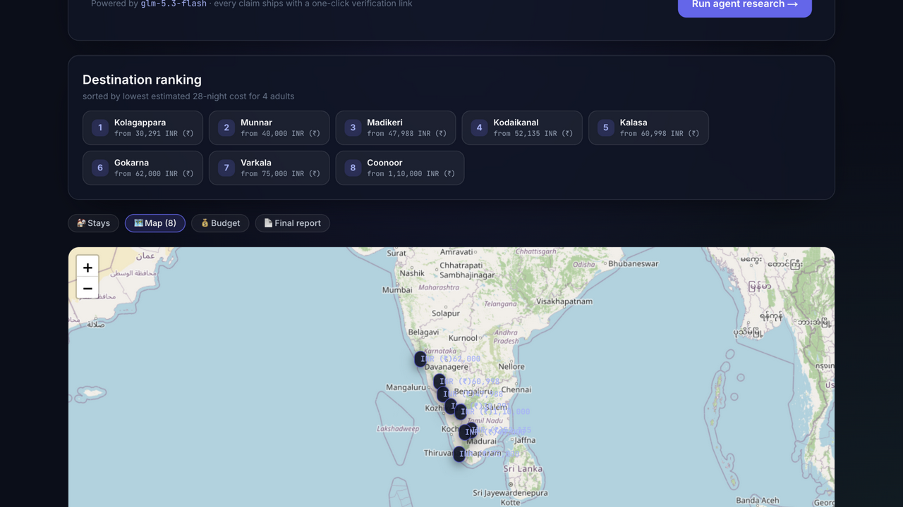
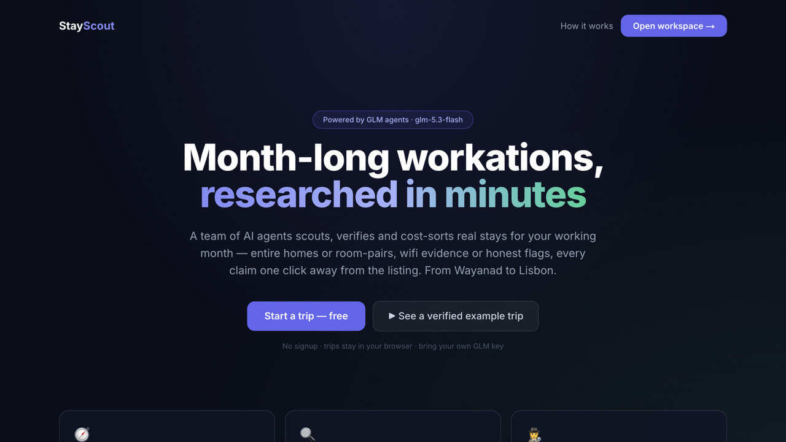
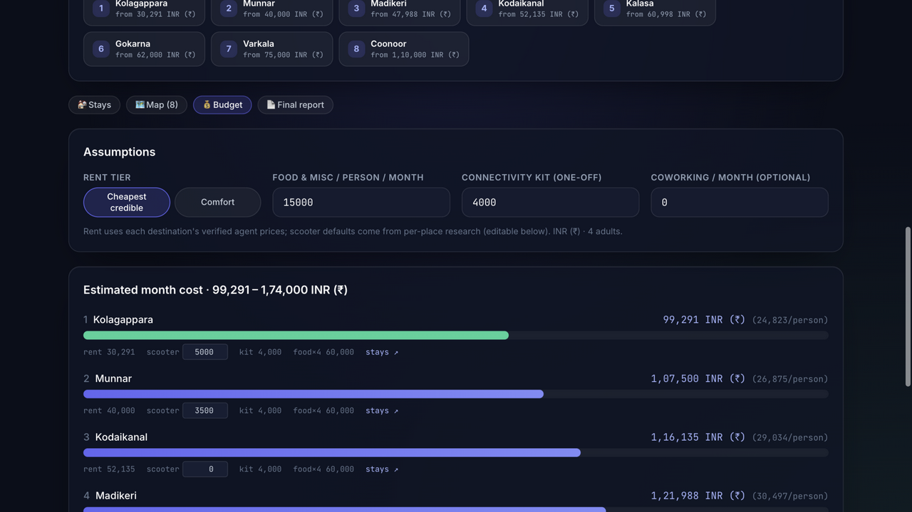
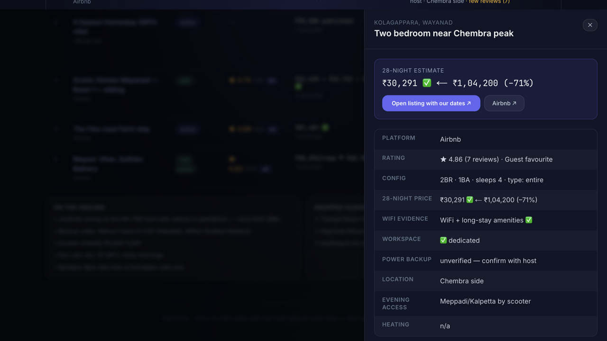

# 🏔️ StayScout

**Multi-agent workation stay research — scout → verify → cost-sort, for any destinations on earth.**

StayScout operationalises the workflow of a serious month-long-stay hunt: enter your destinations, dates and work requirements, and a team of GLM agents researches every place in parallel — planner, destination scouts, a skeptical verifier, and a report composer — then hands you a decisive, cost-sorted shortlist where **every AI claim is one click away from ground truth**.

<div align="center">
  
</div>

## ✨ The agent team

```
┌─────────┐   ┌─────────────────────────┐   ┌───────────┐   ┌──────────┐
│ Planner │ → │ N destination Scouts    │ → │ Verifier  │ → │ Composer │
│ 1 call  │   │ (parallel, ≤4 at once)  │   │ 1 call    │   │ 1 call   │
└─────────┘   └─────────────────────────┘   └───────────┘   └──────────┘
      live SSE progress → results dashboard → markdown report export
```

- **Planner** — normalises destinations (with map coordinates), flags season & peak-surge risks for your exact window
- **Scouts** — one agent per destination; returns 4–6 real, cross-checkable candidates covering entire homes *and* cheaper room-pairs, with honest `est.` pricing for 28+ nights (Airbnb monthly discounts), wifi evidence or explicit "confirm with host", workspace, power backup, evening access, and 2+ sources each — never fabricating what it can't back
- **Verifier** — audits every shortlist against your hard filters; nightly-rate traps, thin sources and missing evidence get flagged
- **Composer** — final markdown report: *Answer First* ranking → one cost-sorted table per place → booking playbook → cost snapshot

## 🎛️ The workspace

| | |
|---|---|
| 🏘️ **Stays** | Cost-sorted table per destination; click any row for a full **evidence drawer** — sources, dated listing link, flags, and a ready-to-send host-validation message |
| 🗺️ **Map** | Destination pins with live from-prices (OpenStreetMap + Leaflet, no API key) |
| 💰 **Budget** | Month-cost calculator: rent tier, editable scooter/food/kit/coworking assumptions, per-person math, ranked bars |
| 📄 **Report** | Rendered markdown report with copy/download |

Plus: named multi-trip history (localStorage), multi-region quick-start sets, one-click **pre-filtered Airbnb searches** per destination (your dates, guests, WiFi amenity, monthly pricing), Booking/Maps/Reddit cross-check links, toasts, and an error boundary.

## 🚀 Quick start

```bash
npm install
cp .env.example .env.local   # add your GLM API key
npm run dev                  # http://localhost:3000
```

**No key yet?** Click **"▶ See a verified example trip"** on the landing page — a real, human-verified South India research run (42 stays with live links) ships as the built-in demo.

### Configuration (`.env.local`)

```bash
GLM_API_KEY=your_glm_api_key_here
GLM_BASE_URL=https://api.z.ai/api/coding/paas/v4   # the endpoint your key was issued for
GLM_MODEL=glm-5.3-flash
```

Any OpenAI-compatible endpoint works — point `GLM_BASE_URL` at it and set your `GLM_MODEL`.

## 💎 The hidden-gem methodology

The full post-mortem lives in [docs/hidden-gems.md](docs/hidden-gems.md) — case study: a user found **Eden's Homestay** in **Chongey Tar** (Gangtok), an Instagram-marketed homestay with a single OTA review, that our agents missed. Four structural gaps were identified; each is now fixed in the pipeline:

A real user found **Eden's Homestay** in **Chongey Tar** (a Gangtok micro-locality) — an offbeat, Instagram-marketed property (`@edenshomestaysikkim`) our agents missed while researching Sikkim. The post-mortem identified four structural gaps, each now fixed:

| Gap | Why we missed it | Fix |
|---|---|---|
| **Fame bias in planning** | The planner expanded "Sikkim" only into the 5 famous hubs — micro-localities like Chongey Tar never got a query | Planner now also returns **micro-locality pockets** (lesser-known villages/pockets) per destination, and scouts are required to cover them |
| **Evidence-bar suppression** | Low review mass (1 Agoda review) reads as "risk" and gets filtered, never surfaced | Scouts must include a **hidden-gem tier**: 1–2 under-reviewed, single-platform properties, honestly flagged `"hidden gem lead — verify on platform/socials"` |
| **No discovery channel** | Agents reason from training knowledge; Instagram-only properties are below the knowledge floor, and the no-fabrication rule (correctly) blocks inventing them | Every destination ships a **💎 Hidden-gem hunt kit**: one-click Instagram hunt, workation-Reddit threads, Google-Maps micro-search, travel-blog sweep, Indian-OTA and hostel-belt queries — the human runs the searches the agents can't |
| **Airbnb-first inventory** | OTAs and Maps hold different long-tail stock | Discovery kit + Booking/Maps/Reddit links per destination cover the non-Airbnb long tail |

The honest architecture note: StayScout agents don't browse the web (the GLM key's plan covers chat only). Discovery is therefore **human-in-the-loop by design** — the agents narrow and structure, the Discovery Kit and verify links put ground truth one click away.

## 🧭 Using it

1. Name the trip, pick a quick-start set (South India, Kerala, Himalayas, global nomad hubs…) or type any destinations
2. Set dates, working adults, seating preference (entire home vs. room-pairs), hard filters (video-call WiFi, dedicated workspace, Guest-favourite only), budget
3. Watch the agent team run live — each scout streams its shortlist as it lands
4. Open each destination's **Verify live** links; click stays for evidence; check the map and budget tabs
5. Copy or download the final markdown report

## 📸 Screenshots

| Landing | Budget calculator |
|---|---|
|  |  |
| **Stay evidence drawer** | **Destination ranking** |
|  |  |

## 🧱 Stack

Next.js 14 (App Router) · Tailwind CSS · SSE streaming · Leaflet + OpenStreetMap · react-markdown · GLM (`glm-5.3-flash`) via the OpenAI-compatible API. CI: typecheck + build on every push.

## 🔒 Notes & troubleshooting

- Your API key lives in `.env.local` (gitignored) and is only used server-side in `/api/research`.
- Agent shortlists are AI-knowledge candidates with source links — the product's design assumption is the same one a good human researcher follows: *never book without opening the listing and sending the validation message (pre-written in every stay drawer).*
- **Blank page / asset 500s while dev is running** — a `next build` corrupted the dev `.next`; stop dev, run `npm run dev:clean`.
- **GLM 429 "insufficient balance"** — your key is bound to a specific endpoint (e.g. the coding-plan URL above); point `GLM_BASE_URL` there.

## 📄 License

MIT
